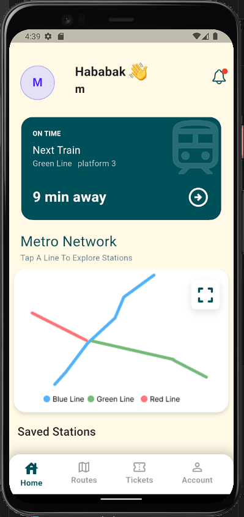
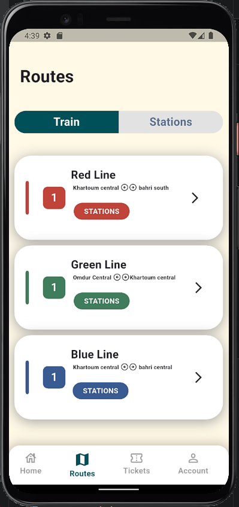
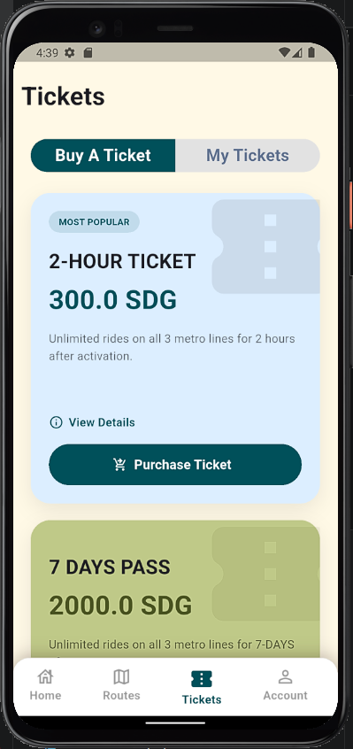
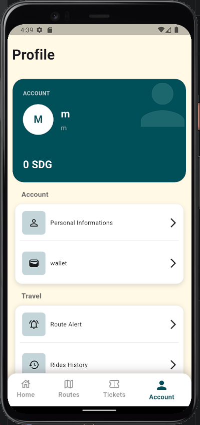
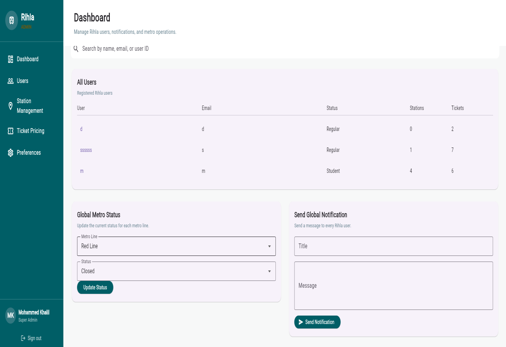
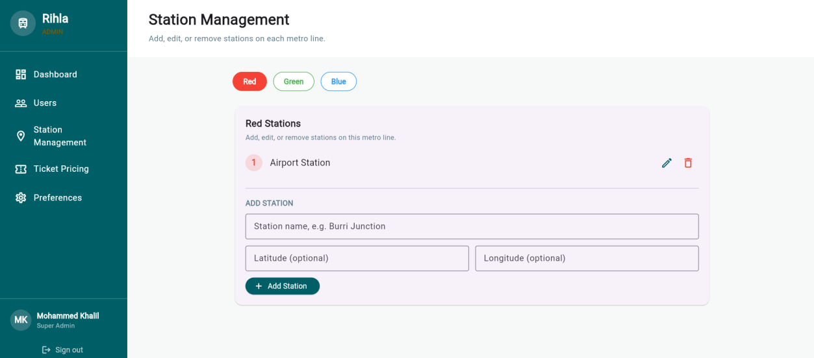

# Rihla Metro Application

Rihla is a Flutter-based metro transportation system developed as a graduation project. It gives passengers a simple way to plan metro journeys, view stations, manage tickets and wallet activity, and receive service updates.

The complete system is divided into three connected projects:

- **Mobile application:** Flutter application used by passengers.
- **Admin portal:** Flutter application used to manage users, stations, tickets, metro statuses, and notifications.
- **Backend API:** PHP and MySQL backend used by both Flutter applications.

## Related Repositories

- [Rihla Mobile Application](https://github.com/m7mad-3baid/Rihla-Metro-Application)
- [Rihla Admin Portal](https://github.com/m7mad-3baid/rihla_admin_portal)
- [Rihla PHP/MySQL Backend](https://github.com/hussamrepos/Rihla-BackEnd)

## Screenshots

### Mobile Application

| Home | Routes |
|---|---|
|  |  |

| Tickets | Profile |
|---|---|
|  |  |

### Admin Portal

| Dashboard | Station Management |
|---|---|
|  |  |

## Mobile Features

- User registration and login.
- Regular-user and student registration.
- Student ID validation.
- Metro station and route browsing.
- Red, Green, and Blue line information.
- Saved and removed favorite stations.
- Next-train information.
- Live metro-line status information.
- Global service notifications.
- Ticket prices and ticket purchasing.
- Wallet top-up and transaction history.
- Purchased-ticket and expiration tracking.
- Ride history.
- Personal-information and password management.
- Interactive metro map.

## Admin Features

The separate admin portal allows administrators to:

- Log in to the administration system.
- View registered users.
- Search and inspect user details.
- View saved stations and purchased tickets for each user.
- Edit or disable user accounts.
- Add, edit, and delete metro stations.
- Update ticket prices.
- Update Red, Green, and Blue line statuses.
- Send global notifications to users.
- Update administrator information.
- Change the administrator password.

## Technology Stack

### Mobile Application

- Flutter and Dart
- HTTP package for API communication
- SharedPreferences for local user-session data
- Flutter Map and LatLong2 for map features
- Video Player for the splash screen

### Admin Portal

- Flutter and Dart
- Material Design widgets
- HTTP package for API communication

### Backend

- PHP
- MySQL
- Apache through XAMPP
- JSON API responses
- Prepared SQL statements
- Password hashing and verification

## Architecture and Data Flow

Both Flutter applications communicate with the PHP backend through HTTP requests.

```text
Flutter screen
    ↓
ApiService
    ↓
HTTP GET or POST request
    ↓
PHP API endpoint
    ↓
MySQL database
    ↓
JSON response
    ↓
Flutter parses the response
    ↓
setState updates the interface
```

For example, saving a station follows this flow:

```text
User selects a station
    ↓
Flutter gets the logged-in user ID
    ↓
ApiService sends the user ID and station ID
    ↓
savestations.php inserts the relationship
    ↓
The response returns as JSON
    ↓
Flutter updates the saved-station state
    ↓
The bookmark icon changes
```

## Mobile Project Structure

```text
lib/
├── data/
├── models/
├── screens/
├── services/
├── themes/
└── widgets/
```

- **Screens** contain pages such as Home, Routes, Tickets, Wallet, and Profile.
- **Models** represent stations, metro statuses, notifications, and next trains.
- **Services** contain API communication, session storage, saved-station logic, and next-train logic.
- **Widgets** contain reusable elements such as the bottom navigation bar, metro previews, line information, and maps.

## Main Mobile Screens

- `MainScreen.dart` controls the main tabs and displays Home, Routes, Tickets, and Profile.
- `home.dart` displays the user greeting, next train, metro network, saved stations, notifications, and quick actions.
- `routes_screen.dart` displays metro lines and stations and handles saved-station actions.
- `line_stations_screen.dart` displays stations belonging to a selected line.
- `Tickets.dart` displays ticket prices, purchased tickets, and ticket details.
- `wallet.dart` handles wallet balance, top-ups, ticket purchases, and transactions.
- `Profile.dart` displays account information and profile actions.

## Backend Responsibilities

The backend provides endpoints for authentication, users, stations, metro status, tickets, wallet activity, notifications, and ride history.

```text
Authentication: login.php, register.php, admin_login.php
Users: getUsers.php, updateprofile.php, admin_update_user.php
Stations: getsavedstations.php, savestations.php, removestations.php, admin_stations.php
Metro status: get_metroStatus.php, update_metroStatus.php
Tickets: get_my_tickets.php, purchase_ticket.php, admin_ticket_prices.php
Wallet: get_balance.php, topup.php, get_transactions.php
Notifications: get_notifications.php, add_notifications.php
Ride history: get_ride_history.php
```

## Database Relationships

The database stores users, administrators, stations, tickets, wallet activity, notifications, metro statuses, and ride history.

```text
users
  ├── saved_stations
  ├── user_tickets
  ├── wallet_transactions
  └── ride_history
```

The `saved_stations` table connects users and stations:

```text
saved_stations.user_id    → users.id
saved_stations.station_id → stations.id
```

## Ticket Purchase Flow

When a user purchases a ticket:

1. Flutter sends the user ID and ticket name.
2. PHP gets the ticket price and duration.
3. PHP gets the user balance and student status.
4. A student discount is applied when applicable.
5. PHP checks whether the balance is sufficient.
6. The price is deducted from the wallet.
7. The purchased ticket is inserted into the database.
8. A negative wallet transaction is recorded.
9. The database transaction is committed.
10. PHP returns the new balance and ticket information as JSON.

## Wallet Flow

```text
User enters an amount
    ↓
Flutter sends the user ID and amount
    ↓
topup.php updates the wallet balance
    ↓
A positive wallet transaction is recorded
    ↓
The updated balance returns to Flutter
```

Positive wallet amounts represent money added. Negative amounts represent money spent, such as ticket purchases.

## Local Session Storage

The mobile application uses `SharedPreferences` to store basic session information locally, including the user ID, name, email, student status, and login status.

## Running the Project Locally

### Requirements

- Flutter SDK
- Dart SDK
- XAMPP
- MySQL
- Android Studio or another Flutter-compatible IDE

### Start the Backend

1. Install and open XAMPP.
2. Start Apache and MySQL.
3. Place the backend folder inside the XAMPP `htdocs` directory.
4. Import the project database through phpMyAdmin.
5. Check the settings in `Rihla_backend/config/database.php`.

The API should be available at a URL similar to:

```text
http://localhost/Rihla_backend/api/
```

The exact URL depends on the local backend folder name.

### Run the Mobile Application

```bash
flutter pub get
flutter run
```

### Run the Admin Portal

Open the admin portal repository separately and run:

```bash
flutter pub get
flutter run
```

Before running either Flutter project, make sure its `ApiService` base URL matches the local XAMPP backend URL.

## Validation and Security

The project includes input validation, JSON success and error responses, password hashing and verification, prepared SQL statements in important operations, database transactions for ticket purchases, and loading, success, error, and empty states in the Flutter interfaces.

For a production system, further improvements would include HTTPS, stronger API authentication, server-side authorization, environment variables for secrets, centralized logging, and additional request protection.

## Project Goals

Rihla demonstrates Flutter widget composition, Stateful and Stateless widgets, navigation, callbacks, `setState`, asynchronous programming, HTTP GET and POST requests, JSON parsing, SharedPreferences, PHP API development, MySQL CRUD operations, relational database design, wallet transactions, ticket purchasing, and administrative workflows.

## Project Status

Rihla is an educational graduation-project prototype demonstrating how a mobile application, an admin portal, a PHP API, and a relational database can work together as one metro transportation management system.

## Contributors

- Mohammed Abdalwahid
- Add other team members here.

## License

This project was developed for educational and graduation-project purposes.
